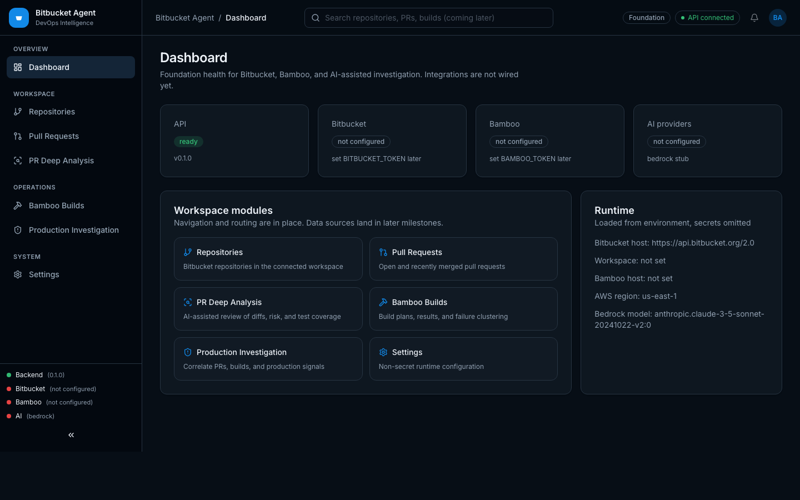
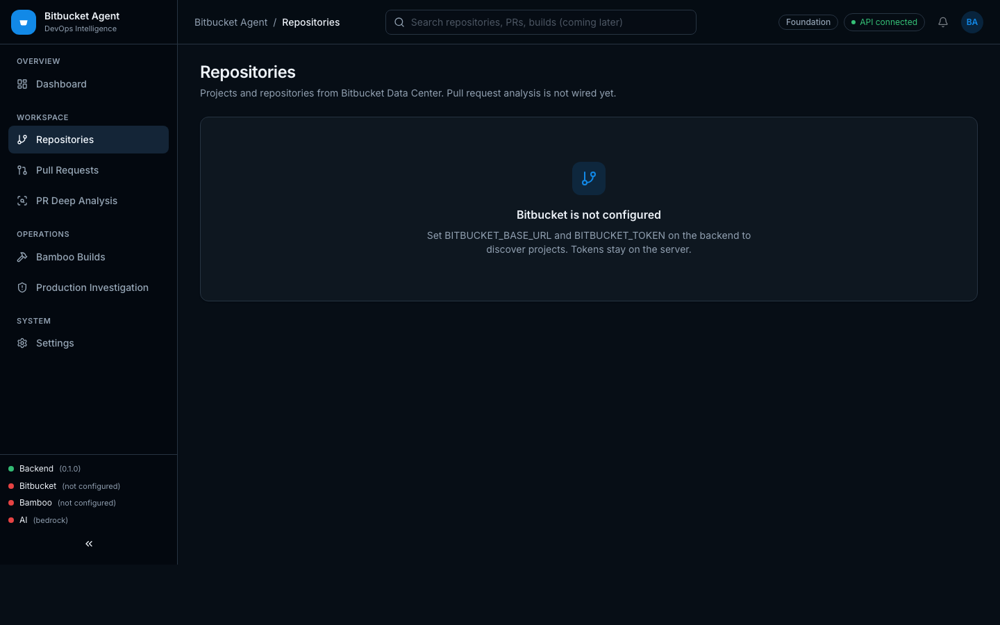
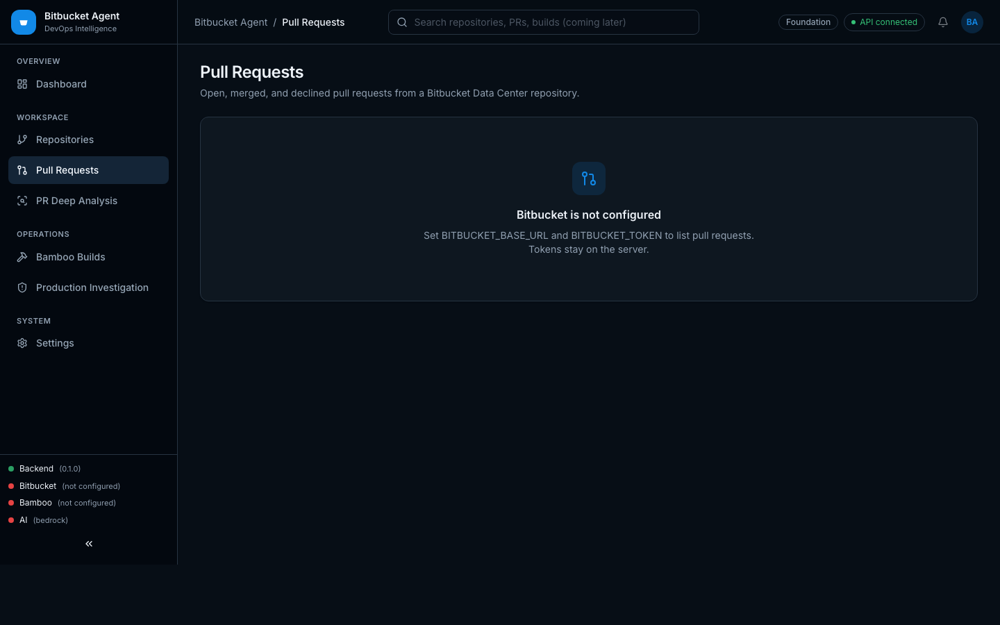
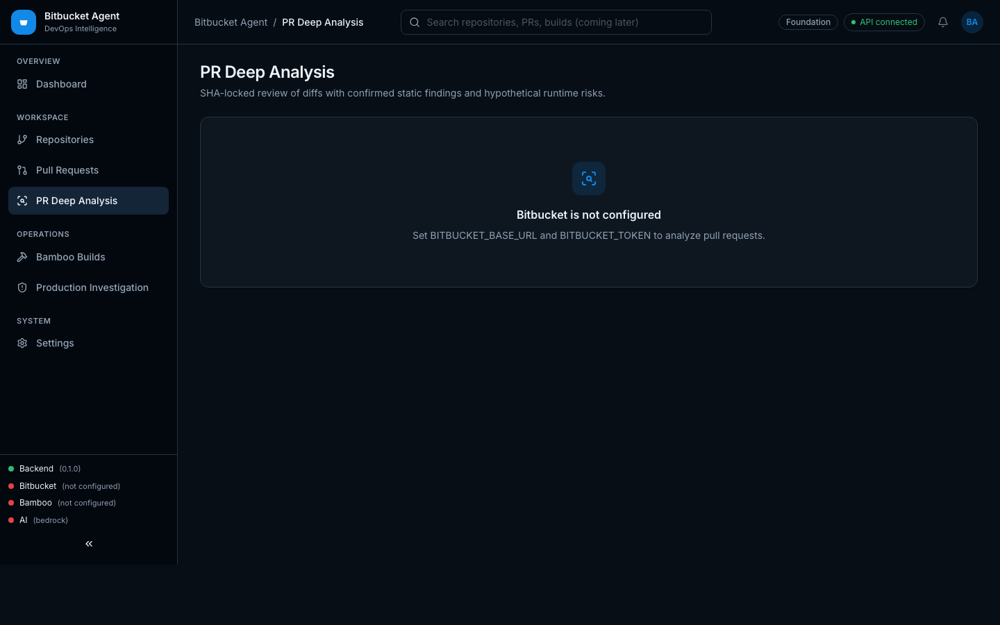
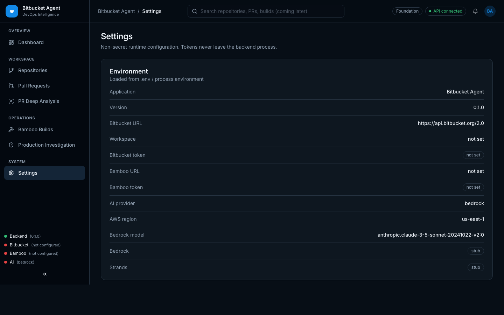

# Bitbucket Agent

Enterprise DevOps intelligence for Bitbucket repositories, pull requests, Bamboo CI, and production investigation. Amazon Bedrock and Strands Agents will power analysis in a later milestone.

The backend can connect to **Bitbucket Data Center 10.2.x** with an HTTP access token, discover projects and repositories, compare PR revisions, and run PR deep analysis. Bamboo ingestion is **not implemented yet**. Live Bedrock/Strands inference is optional; static findings still run when the model is off.

**Repo:** https://github.com/sandeepk24/bitbucket-agent  
**Author:** [sandeepk24](https://github.com/sandeepk24)

## Screenshots

### Dashboard



### Repositories



### Pull requests



### PR Deep Analysis



### Settings



---

## What works today

- FastAPI backend with structured logging, CORS, `/api/v1/health`, `/api/v1/ready`, and `/api/v1/settings`
- Bitbucket Data Center 10.2 client for projects, repositories, pull requests, SHA-locked before/after diffs, and PR deep analysis
- React + Vite + TypeScript dashboard with sidebar, top navigation, and seven workspace pages
- Environment-based configuration (Pydantic Settings)
- AI provider **interfaces** for Amazon Bedrock and Strands Agents (stubs)
- Docker Compose for local backend + frontend
- pytest (backend) and Vitest (frontend)

## What is not implemented

| Capability | Status |
| --- | --- |
| Bitbucket REST (projects, repos, PRs) | Data Center 10.2.x |
| Pull request list and detail UI | Live |
| PR before/after code comparison | Live |
| PR deep analysis | Live (static + optional model) |
| Bamboo build ingestion | Not started |
| Production investigation | Not started |
| Bedrock `InvokeModel` | Interface only |
| Strands Agents runtime | Interface only |

---

## Repository layout

```
bitbucket-agent/
├── frontend/     React + Vite + TypeScript UI
├── backend/      FastAPI + Pydantic v2 API
├── docs/         Architecture, API, screenshots, implementation plan
└── docker/       Dockerfiles and nginx config
```

---

## Local development

### Prerequisites

- Node.js 20+
- Python 3.12+
- Docker (optional, for Compose)

### Backend

```bash
cd backend
python3 -m venv .venv
source .venv/bin/activate
pip install -e ".[dev]"
cp ../.env.example ../.env
uvicorn app.main:app --reload --port 8000
```

- API docs: http://localhost:8000/docs
- Health: http://localhost:8000/api/v1/health
- Bitbucket health: http://localhost:8000/api/bitbucket/health
- Ready: http://localhost:8000/api/v1/ready

### Frontend

```bash
cd frontend
npm install
npm run dev
```

Open http://localhost:5173. Vite proxies `/api` to the backend.

### Docker Compose

```bash
cp .env.example .env
docker compose up --build
```

- UI: http://localhost:8080
- API: http://localhost:8000/api/v1/health

---

## Tests

```bash
# Backend
cd backend
source .venv/bin/activate
pytest

# Frontend
cd frontend
npm test
```

---

## Configuration

Copy `.env.example` to `.env`. Important variables:

| Variable | Purpose |
| --- | --- |
| `BITBUCKET_BASE_URL` | Data Center instance root, e.g. `https://bitbucket.example.com` |
| `BITBUCKET_TOKEN` | HTTP access token — never logged or returned |
| `BITBUCKET_USERNAME` | Optional; when set, REST uses Basic `username:token` |
| `BITBUCKET_MAX_FILE_BYTES` | Skip rendering files larger than this in PR comparison (default 1 MiB) |
| `BAMBOO_BASE_URL` | Bamboo host (unused until Milestone 3) |
| `BAMBOO_TOKEN` | Bamboo token — never logged or returned |
| `AI_PROVIDER` | `bedrock` or `strands` |
| `BEDROCK_ENABLED` | Must stay `false` until inference is implemented |
| `STRANDS_ENABLED` | Must stay `false` until the agent runtime is implemented |

---

## Dashboard navigation

| Page | Route | Purpose |
| --- | --- | --- |
| Dashboard | `/` | Platform health and foundation status |
| Repositories | `/repositories` | Bitbucket project and repository discovery |
| Pull Requests | `/pull-requests` | Open, merged, and declined PRs |
| PR Deep Analysis | `/pr-analysis` | Findings, risk, and SHA-locked diffs |
| Bamboo Builds | `/bamboo` | CI build intelligence (placeholder) |
| Production Investigation | `/production` | Incident investigation (placeholder) |
| Settings | `/settings` | Non-secret runtime configuration |

---

## License

MIT
